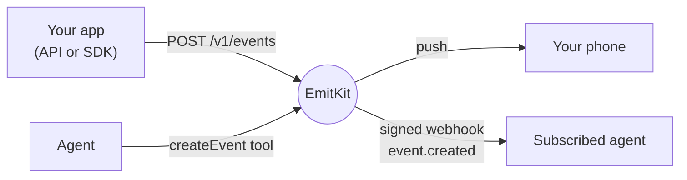

EmitKit connects to agents in two directions, and they can sign in with
OAuth or use an API key. Agents **send** events through
the MCP server's tools, the same way your code uses the API. With MCP Events
they can also **hear about** new events as they happen: EmitKit posts each
one to the agent as a signed webhook, and the agent can act on it.

| Integration | What it does | Status |
| --- | --- | --- |
| [ChatGPT, Claude and MCP clients](/integrations/oauth) | Connect by signing in to EmitKit and picking a Project, no API key needed | <Badge variant="accent">New</Badge> |
| [MCP tools](/mcp) | Agents create events and manage identities with `createEvent`, `identifyUser` and `deleteIdentity` | <Badge variant="success">Available</Badge> |
| [MCP Events](/integrations/mcp-events) | Agents subscribe to `event.created` and get each new event as a signed webhook | <Badge variant="accent">New</Badge> |
| [Webhook receiver](/integrations/webhook-receiver) | Receive MCP Events in your own service: verify signatures, handle retries | <Badge variant="accent">New</Badge> |

<CardGroup cols={2}>
  <Card title="Connect with OAuth" href="/integrations/oauth" icon="log-in">
    ChatGPT, Claude and Claude Code sign in and pick a Project.
  </Card>
  <Card title="MCP Events" href="/integrations/mcp-events" icon="radio-tower">
    Let an agent subscribe to new events, filtered by channel, tag or user.
  </Card>
  <Card title="Build a webhook receiver" href="/integrations/webhook-receiver" icon="webhook">
    Answer the verification handshake and check every signature.
  </Card>
  <Card title="Connect an MCP client" href="/mcp/clients" icon="plug">
    Claude Code and other clients that send an API key header.
  </Card>
</CardGroup>
