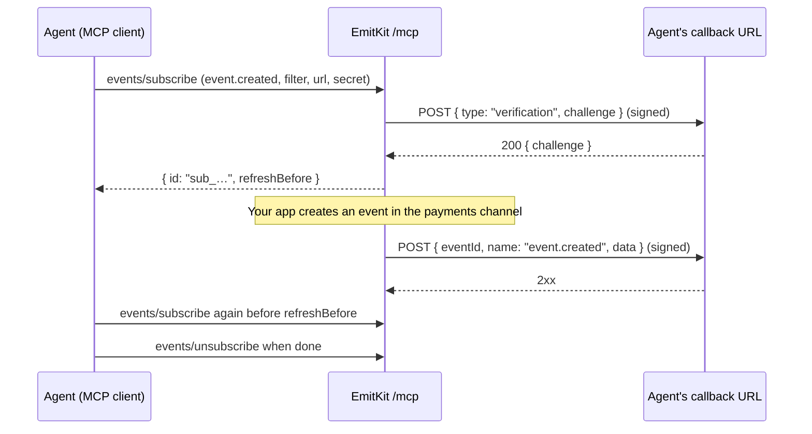

MCP Events lets an agent **subscribe** to what happens in your product instead
of polling for it. The agent asks EmitKit's MCP server for `event.created`,
optionally filtered by channel, tag or user. From then on EmitKit posts each
matching event to the agent's callback URL as a signed
[Standard Webhooks](https://www.standardwebhooks.com) request.

It follows the [MCP Events draft](https://github.com/modelcontextprotocol/experimental-ext-triggers-events/blob/main/docs/design-sketch-proposal.md)
with webhook delivery, on MCP protocol version `2026-07-28` and on the earlier
versions that use `initialize`, at the same endpoint as the tools:

```text
https://api.emitkit.com/mcp
```



:::note
Clients that [connect with OAuth](/integrations/oauth), such as ChatGPT and
Claude, subscribe the same way. Their subscriptions belong to the connection
and end when you revoke it.
:::

## Before you start

- An [OAuth connection](/integrations/oauth) or an [API key](/api/api-keys)
  for the Project the agent should hear about. **Give the agent its own
  credentials.** EmitKit doesn't send an event back to the key or connection
  that created it (see [No feedback loops](#no-feedback-loops)), so an agent
  that shares your app's key would miss your app's events.
- A public `https` URL that answers the verification handshake and checks
  signatures. [Build a webhook receiver](/integrations/webhook-receiver) shows
  how.
- A signing secret you generate: `whsec_` followed by the base64 of 24 to 64
  random bytes.

```bash
echo "whsec_$(openssl rand -base64 32)"
```

## Discover the server

Every modern request carries its protocol version in `params._meta` and in the
`MCP-Protocol-Version` header, and the method in `Mcp-Method`:

```bash
curl https://api.emitkit.com/mcp \
  -H "Authorization: Bearer $EMITKIT_AGENT_KEY" \
  -H "Content-Type: application/json" \
  -H "MCP-Protocol-Version: 2026-07-28" \
  -H "Mcp-Method: server/discover" \
  -d '{
    "jsonrpc": "2.0", "id": 1, "method": "server/discover",
    "params": { "_meta": {
      "io.modelcontextprotocol/protocolVersion": "2026-07-28",
      "io.modelcontextprotocol/clientCapabilities": {}
    } }
  }'
```

```json
{
  "jsonrpc": "2.0",
  "id": 1,
  "result": {
    "supportedVersions": ["2026-07-28", "2025-11-25", "2025-06-18", "2025-03-26", "2024-11-05"],
    "capabilities": { "tools": {}, "events": {} },
    "_meta": { "io.modelcontextprotocol/serverInfo": { "name": "emitkit", "title": "EmitKit", "version": "3.0.0" } },
    "instructions": "…",
    "resultType": "complete"
  }
}
```

Clients on older protocol versions start with `initialize`, whose capabilities
list `events` too. They call the same `events/*` methods without the headers
and `_meta` shown on this page. Errors from those methods arrive in an HTTP
`200`. A missing or invalid credential is still `401`, and a spent rate limit
`429`.

On `2026-07-28`, if a header doesn't match the body, EmitKit answers `400` with
error `-32020`. An unsupported version gets `400` with `-32022` and
the supported list, and an unknown method gets `404` with `-32601`.

## The event: `event.created`

`events/list` describes it. It fires for every event a sender or agent creates
in the key's Project (a recorded answer to a question doesn't count), including events sent with `notify: false`, because `notify` only
controls push notifications.

<Tabs>
  <Tab title="Filter (arguments)">

All filters are optional, and every one you give must match.

| Argument | Type | Matches |
| --- | --- | --- |
| `channel` | string | Events in this channel. Named the way EmitKit names channels, so `"Payments"` matches `payments` |
| `tags` | string[] (up to 10) | Events that carry every one of these tags |
| `userId` | string | Events about this user, by your user id (after alias resolution) |

  </Tab>
  <Tab title="Payload (data)">

| Field | Type | Notes |
| --- | --- | --- |
| `id` | string | The event id, also `eventId` and `webhook-id` |
| `channel` | string | Channel name |
| `title` | string | |
| `description` | string or null | |
| `icon` | string or null | An emoji |
| `tags` | string[] | |
| `metadata` | object | As sent, including `amount`/`currency` |
| `userId` | string or null | |
| `source` | string | `api`, `mcp` or what the sender set |
| `createdAt` | string | ISO 8601, UTC |
| `url` | string | The channel in the EmitKit dashboard |

  </Tab>
</Tabs>

:::warning
Titles, descriptions and metadata are written by whoever sends the event.
Treat them as data, never as instructions to your agent.
:::

## Subscribe

<Steps>
  <Step title="Call events/subscribe">

```json
{
  "jsonrpc": "2.0",
  "id": 2,
  "method": "events/subscribe",
  "params": {
    "_meta": {
      "io.modelcontextprotocol/protocolVersion": "2026-07-28",
      "io.modelcontextprotocol/clientCapabilities": {}
    },
    "name": "event.created",
    "arguments": { "channel": "payments", "tags": ["failed"] },
    "delivery": {
      "mode": "webhook",
      "url": "https://agent.example.com/hooks/emitkit",
      "secret": "whsec_…"
    },
    "cursor": null,
    "ttlMs": 86400000
  }
}
```

Send it with the headers `MCP-Protocol-Version: 2026-07-28` and
`Mcp-Method: events/subscribe`.

  </Step>
  <Step title="Answer the verification request">
    Before the subscription exists, EmitKit sends a signed
    `{"type": "verification", "challenge": "…"}` to your URL. Reply `2xx` with
    exactly `{"challenge": "<the same value>"}`. EmitKit can skip the handshake
    for a URL that key or connected app verified in the last 24 hours, but
    any subscribe or refresh may send one, so answer every verification
    request.
  </Step>
  <Step title="Keep the subscription id">

```json
{
  "id": "sub_4f0c9d8e2b7a41d6a9c3e5f7b1d2c3a4",
  "refreshBefore": "2026-10-01T12:00:00.000Z",
  "cursor": null,
  "truncated": false,
  "resultType": "complete"
}
```

    Every delivery carries this id in `X-MCP-Subscription-Id`. It's derived
    from the key, URL, event name and arguments, so it stays the same when you
    refresh.
  </Step>
</Steps>

### Refresh, rotate and stop

- **Refresh** by calling `events/subscribe` again with the same `name`,
  `arguments` and `delivery.url` before `refreshBefore`. Subscribing twice
  never creates a second subscription. Subscriptions that aren't refreshed
  stop, and are deleted within the hour.
- **Lifetime:** `ttlMs` defaults to 24 hours. EmitKit grants at least
  1 minute and at most 7 days. `ttlMs: null` gets 7 days: EmitKit never grants
  a subscription without an expiry.
- **Rotate the secret** by refreshing with a new `delivery.secret`. For the
  next hour, deliveries carry two signatures, one for each secret, so your
  receiver can switch over at its own pace.
- **Stop** with `events/unsubscribe`. It takes the same `name`, `arguments`
  and `delivery.url`, and answers `{}` even when there was nothing to remove.

```json
{
  "jsonrpc": "2.0",
  "id": 3,
  "method": "events/unsubscribe",
  "params": {
    "_meta": { "io.modelcontextprotocol/protocolVersion": "2026-07-28", "io.modelcontextprotocol/clientCapabilities": {} },
    "name": "event.created",
    "arguments": { "channel": "payments", "tags": ["failed"] },
    "delivery": { "mode": "webhook", "url": "https://agent.example.com/hooks/emitkit" }
  }
}
```

EmitKit doesn't replay missed events: `cursor` is always `null` and
`truncated` always `false`. To catch up after downtime, read the dashboard
feed.

## Deliveries

One event per request, as a `POST` with `Content-Type: application/json`:

```http
POST /hooks/emitkit HTTP/1.1
Host: agent.example.com
Content-Type: application/json
webhook-id: event_k2m9x7q4r8t1v5w3y6z0a2b4
webhook-timestamp: 1790856300
webhook-signature: v1,K5oZfzN95Z9UVu1EsfQmfVNQhnkZ2pj9o9NDN/H/pI4=
X-MCP-Subscription-Id: sub_4f0c9d8e2b7a41d6a9c3e5f7b1d2c3a4

{
  "eventId": "event_k2m9x7q4r8t1v5w3y6z0a2b4",
  "name": "event.created",
  "timestamp": "2026-09-30T12:05:00.000Z",
  "data": {
    "id": "event_k2m9x7q4r8t1v5w3y6z0a2b4",
    "channel": "payments",
    "title": "Payment failed",
    "description": "Card declined · Pro plan",
    "icon": "💳",
    "tags": ["failed"],
    "metadata": { "amount": 49, "currency": "EUR" },
    "userId": "cus_123",
    "source": "api",
    "createdAt": "2026-09-30T12:05:00.000Z",
    "url": "https://app.emitkit.com/acme?channelId=channel_…"
  },
  "cursor": null
}
```

| Your reply | What EmitKit does |
| --- | --- |
| `2xx` | Delivered |
| `408`, `425`, `429`, `5xx`, timeout (10 s) or no connection | Tries again after 10, 20 and 40 seconds, then gives up |
| `410 Gone` | Deletes the subscription, and doesn't try again. Your next refresh creates it again |
| Any other `3xx` or `4xx` | Doesn't try again. Redirects are never followed |

Once an event is queued, deliveries are at least once. A retry keeps the same `webhook-id` (the event
id) with a fresh timestamp and signature, so use `webhook-id` to skip
duplicates. Events can arrive out of order.

## No feedback loops

An agent that reacts to an event by creating another one would otherwise hear
about its own event, react again, and so on. EmitKit never delivers an event
to subscriptions of the API key or OAuth connection that created it. Give the
agent its own key or connection, and use a different key for your app.

## Access and limits

- The API key or OAuth connection is the subscriber. Revoke or rotate the key,
  revoke the connection, delete its Project, or stop being an owner or admin
  of the organization, and deliveries stop straight away.
- A key or connection can hold 25 subscriptions. The 26th gets `-32025` with
  `data.limit: "subscriptions"`.
- Subscribing needs a key that can read events: full keys and
  [read-only keys](/api/api-keys) both can.
- Every request counts toward the same 100 requests per minute as tool calls.
- Callback URLs must use `https` and a public host name or address. EmitKit
  refuses credentials in the URL, private and loopback addresses (including
  IPv6 addresses that carry an IPv4 one, such as 6to4 and Teredo), and names
  such as `localhost` or `*.internal`, with or without a trailing dot. It
  never follows redirects.

## Errors

| Code | Meaning | When |
| --- | --- | --- |
| `-32602` | Invalid params | Arguments outside the event's `inputSchema`, a bad URL, or a secret that isn't `whsec_` plus 24 to 64 bytes |
| `-32023` | Not found | Unknown event name (`data.kind: "event"`) |
| `-32024` | Forbidden | A key that isn't bound to a Project. A missing or invalid key or token gets HTTP `401` before any method runs, and a spent rate limit HTTP `429` |
| `-32025` | Resource exhausted | 25 subscriptions reached |
| `-32026` | Unsupported | A delivery mode other than `webhook` |
| `-32015` | Callback endpoint error | Verification failed. `data.reason` is `challenge_failed`, `http_4xx`, `http_5xx`, `timeout`, `tls_error` or `connection_refused` |
